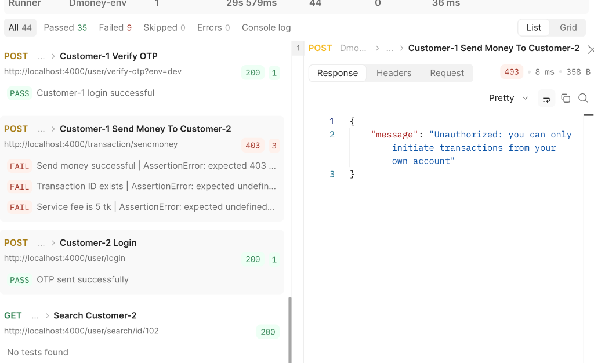

# Integration Testing with Postman & Newman

### **Batch No:** 20  
### **Topic:** Assignment on API Testing (Integration Testing with Postman)  
### **Author:** Torab Arnob  

---

## 📌 Project Overview
This repository contains an end-to-end automated API integration testing suite for the **DMoney Transaction API** using **Postman** and **Newman**. 

The test suite validates financial transaction workflows across different user roles (**Admin**, **System**, **Agent**, **Customer**, and **Merchant**) following real-world fintech scenarios. It tests both **positive and negative test cases**, validating HTTP response codes, JSON schema structures, JWT authorization tokens, account balances, service charges, and agent commission calculations.

---

## 🔗 Important Links
- **Published Postman API Documentation:**  
  👉 [Postman Live API Documentation](https://documenter.getpostman.com/view/49804126/2sBYHYuJ15)
- **GitHub Repository:**  
  👉 [Integration Testing with Postman](https://github.com/Torabarnob203311003/Integration-testing-with-Postman)
- **Test Scenarios Matrix:**  
  👉 [Google Sheets / Drive Test Cases](https://docs.google.com/spreadsheets/d/1BxiMVs0XRA5nFMdKvBdBZjgmUUqptlbs74OgvE2upms/edit?usp=sharing)

---

## 🏗️ Architecture & Scenario Workflow

The test suite executes the complete business logic in the following sequence:

```
[Admin Login]
      │
      ▼
[User Creation: Customer-1, Customer-2, Agent, Merchant] (Dynamic Email, Phone, NID)
      │
      ▼
[User Activation by Admin] (PATCH /user/update/:id -> Status: active)
      │
      ▼
[System Deposit] (System deposits 5000 TK to Agent)
      │
      ▼
[Agent Login & OTP Verification] -> [Agent Deposit 2000 TK to Customer-1] (Assert Commission)
      │
      ▼
[Customer-1 Login & OTP Verification] -> [Send Money 1000 TK to Customer-2] (Assert 5 TK Fee)
      │
      ▼
[Customer-2 Login & OTP Verification] -> [Cashout 500 TK to Agent] (Assert Fee)
      │
      ▼
[Customer-2 Payment 400 TK to Merchant]
      │
      ▼
[Negative Test Cases Execution] (Auth, Balance, Validation, Invalid Input)
```

---

## 📋 Test Scenarios Covered

### Positive Scenarios:
1. **Admin Login:** Authentication and extraction of `adminToken`.
2. **Dynamic User Creation:** Generation of dynamic phone numbers (`017...`, `018...`), NIDs (10 digits), and emails for Customer 1 & 2, Agent, and Merchant.
3. **User Activation:** Updating user status from `pending` to `active` via Admin PATCH endpoint.
4. **System Deposit:** System user transfers `5,000 TK` to the Agent account.
5. **Agent Deposit:** Agent deposits `2,000 TK` to Customer-1. Assertion verifies Agent receives the correct commission.
6. **Send Money:** Customer-1 transfers `1,000 TK` to Customer-2. Assertion validates `5 TK` service charge deduction.
7. **Cashout:** Customer-2 withdraws `500 TK` via Agent. Assertion validates withdrawal fee deduction.
8. **Payment:** Customer-2 pays `400 TK` to Merchant.

### Negative Scenarios:
1. **Admin Login with Wrong Password:** Validates `401 Unauthorized` response.
2. **User Creation Without NID:** Validates `400 Bad Request` with appropriate validation message.
3. **Negative Deposit Amount:** Validates transaction failure when amount is less than or equal to 0.
4. **Send Money More Than Available Balance:** Validates transaction rejection for insufficient balance.
5. **Payment Without Token:** Validates `401/403` error when authorization header is missing.

---

## 📁 Repository Structure
```text
├── .gitignore                          # Excludes node_modules, Reports, and .env
├── package.json                        # NPM runner scripts and dependencies
├── README.md                           # Comprehensive documentation & execution guide
├── screenshots/
│   └── newman_report_summary.png       # Test execution report screenshot
└── collection/
    ├── dmoney_api_collection.json      # Complete Postman Collection (v2.1)
    └── dmoney_environment.json         # Postman Environment Variables
```

---

## 🛠️ Prerequisites
Before running tests, ensure you have the following installed on your machine:
- **Node.js** (v16.x or higher)
- **NPM** (v8.x or higher)
- **Git**
- **Newman** (CLI runner for Postman)

---

## 🚀 Step-by-Step Run Instructions

### Step 1: Clone the Repository
```bash
git clone https://github.com/Torabarnob203311003/Integration-testing-with-Postman.git
cd Integration-testing-with-Postman
```

### Step 2: Install Project Dependencies
```bash
npm install
```

### Step 3: Start the DMoney Backend API Server
Ensure the backend server (`dmoney-transaction-api`) is running locally on port 4000:
```bash
# In your backend project directory:
npm install
npm run dev
# Server will listen on http://localhost:4000
```

### Step 4: Run Tests via Newman (CLI)
Execute all test cases with a 500ms delay between requests to ensure seamless database state propagation:
```bash
npm test
```
*Or execute directly with Newman:*
```bash
npx newman run collection/dmoney_api_collection.json -e collection/dmoney_environment.json --delay-request 500
```

### Step 5: Generate HTML Test Execution Report
To generate a comprehensive HTML report:
```bash
npm run report
```
The report will be created inside the `Reports/` directory (e.g., `Reports/report.html`). Open it in any browser to inspect the detailed execution log.

---

## 🖥️ Running in Postman App

1. Open Postman.
2. Click **Import** (top left).
3. Select and import:
   - `collection/dmoney_api_collection.json`
   - `collection/dmoney_environment.json`
4. Select the active environment as **`Dmoney-env`** from the top right environment dropdown.
5. Right-click the **`Dmoney API Testing-20`** collection and choose **Run collection**.
6. Set **Delay** to `500 ms` and click **Run Dmoney API Testing-20**.

---

## 📊 Test Execution Summary Screenshot

Below is the execution result summary from Postman / Newman:



---

## 🛡️ Deliverables & Rubric Compliance Checklist
- [x] **Postman Collection with assertions (70 marks):** Complete flow + negative scenarios satisfied.
- [x] **API Documentation (5 marks):** Published public Postman doc link included.
- [x] **README.md (5 marks):** Fully detailed with links, scenarios, prerequisites, and instructions.
- [x] **Newman Report & Screenshot (10 marks):** Screenshot embedded into README.
- [x] **.gitignore (10 marks):** Correctly excludes `node_modules/`, `Reports/`, and `.env`.
